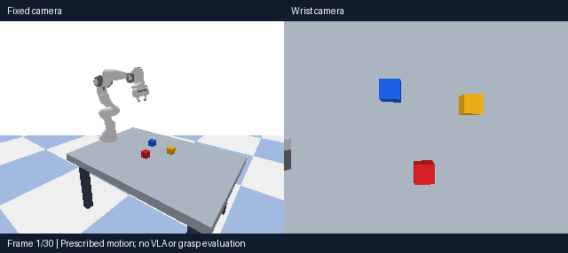
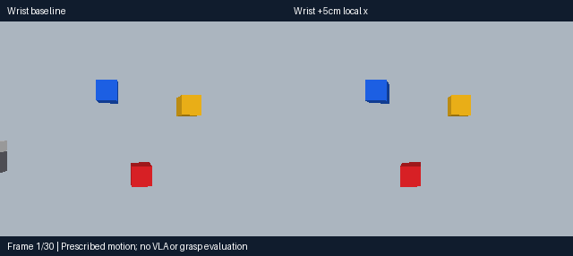

# 机械臂双视角仿真记录

**本阶段已于 2026 年 11 月 27 日收尾。** 孙蓝郁在 AI 工具辅助下，在 Colab 完成两次小型仿真：固定相机与手腕相机观察，以及手腕相机横向偏移 5 cm 的对照。两次原始文件均已核查并保留。

## 组会汇报

- [五页汇报材料](reports/robot_arm_group_meeting_2026-11-27.pptx)
- [三分钟中文口头稿、五页提纲与问答](reports/2026-11-27-group-meeting.md)

完成范围是基础场景运行、相机采集、单参数对照与初步观察。机械臂执行预设关节运动，尚未进行 VLA 模型训练、抓取任务或成功率评测。

## 第一次：固定相机与手腕相机



左侧相机固定在外部，右侧相机随机械臂手部运动。每路 320×240 像素，共 30 帧，一轮播放 3 秒。部分帧中，红色方块接触手腕图像的下边缘。

[运行记录](results/user_colab/20261127T044151Z/record.md) · [截图](results/user_colab/20261127T044151Z/comparison.png) · [实际代码](results/user_colab/20261127T044151Z/demo.py) · [原始元数据](results/user_colab/20261127T044151Z/metadata.json)

## 第二次：只改变相机横向安装位置



左侧是原始手腕相机，右侧沿原始相机光学局部 +x 方向平移 5 cm。两相机朝向相同，在同一物理状态下连续渲染。机器人运动与第一次运行一致。

右图的方块区域整体向左变化，红色方块下缘裁切仍然存在。这组对照支持对相机位移与图像变化关系的初步理解，不能据此声称视野或模型性能提升。

[运行记录](results/user_colab/20261127T054546Z_shift_x5cm/record.md) · [截图](results/user_colab/20261127T054546Z_shift_x5cm/comparison.png) · [实际代码](results/user_colab/20261127T054546Z_shift_x5cm/demo.py) · [核查数据](results/user_colab/20261127T054546Z_shift_x5cm/verification.json)

## 记录与来源

| 内容 | 位置 |
| --- | --- |
| 两次用户运行与助手示例 | [结果目录](results/README.md)、[实验登记](experiments/registry.csv) |
| 当前完成范围 | [范围说明](docs/research_scope.md)、[阶段状态](docs/roadmap.md) |
| 两路相机坐标约定 | [操作说明](docs/experiment_protocol.md)、[横向偏移对照](docs/camera_shift_step.md) |
| 代码和资料来源 | [来源说明](docs/provenance.md) |
| 后续保存方式 | [Git 记录方式](docs/git_workflow.md) |

师兄提供的 RP 是外部学习参考。公开快照不包含 RP 原文，也不导入曾包含原文的旧仓库历史。PyBullet 和 Panda 模型均为第三方软件与资产，演示代码由 AI 助手协助编写。

助手此前生成的 [64 帧四视角示例](results/example/record.md) 单独保存，不计入用户这两次运行的结果。

## 复现入口

本阶段不再追加实验。需要复现时，可使用 [Colab 复制粘贴入口](docs/paste_quickstart.md) 和 [横向偏移代码格](docs/camera_shift_step.md)，或参考 [完整运行指南](docs/quickstart.md)。

有 Python 3.11 的 Linux 环境时，仓库另提供四视角示例：

```bash
python3.11 -m venv .venv
source .venv/bin/activate
python -m pip install --only-binary=:all: -r requirements.txt
python scripts/run_demo.py
```

该命令生成助手示例所用的四视角版本，与上述两次用户快速版分别记录。原生 Mac 安装和 GUI 未验证。
