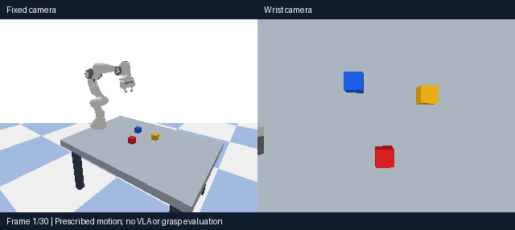

# 用户 Colab 双视角仿真记录

**后续更新：用户随后已完成 [横向 +5 cm 对照](../20261127T054546Z_shift_x5cm/record.md)，两次实验均已收尾。以下保留第一次运行时的记录及当时的下一步计划。**

**记录编号：USER-20261127-001。状态：运行完成，用户上传的四个原始文件已核对。**

用户在 Colab 执行了 AI 助手协助编写的基础机械臂演示，随后提供动图、截图、实际脚本和运行记录。本目录按原始字节保存这四个文件。核查时读取已有数据，没有重新执行仿真，也没有用助手先前的运行产物替换用户附件。

## 直接查看结果



左侧是固定外部相机，右侧是绑定在 `panda_hand` 上、随手部运动的虚拟相机。两幅画面来自同一段预设关节运动；脚本在两路渲染之间没有执行物理步进。

| 文件 | 内容 |
| --- | --- |
| [comparison.gif](comparison.gif) | 30 帧双视角动画，一轮播放 3 秒 |
| [comparison.png](comparison.png) | 第 11 帧的双视角截图 |
| [demo.py](demo.py) | 用户这次实际执行并上传的脚本 |
| [metadata.json](metadata.json) | 原始版本信息、运行时间及 30 组关节和相机状态 |
| [config.json](config.json) | 核查时从脚本及元数据整理的配置快照，并非此次运行的输入文件 |
| [verification.json](verification.json) | 文件对应关系、图像及几何检查的计算结果和方法 |
| [checksums.json](checksums.json) | 四个原始文件的字节数与 SHA-256 |

## 实际运行参数

| 项目 | 记录 |
| --- | --- |
| 开始时间 | 2026-11-27 04:41:51.967070 UTC（当天英国时间相同） |
| 完成时间 | 2026-11-27 04:41:58.548879 UTC |
| 脚本内记录的墙钟耗时 | 6.581809 秒，不包含外层环境安装等全部操作 |
| 软件 | Python 3.11.18；PyBullet 3.2.7；NumPy 2.4.6；Pillow 13.0.0 |
| 场景 | Franka Panda、桌子、红蓝黄三个方块 |
| 计算与渲染 | PyBullet DIRECT，CPU TinyRenderer |
| 相机 | 固定外部相机、手腕相机，共两路 |
| 单路图像 | 320 × 240 像素；含标题的合成图为 640 × 286 像素 |
| 动图 | 30 帧，每帧 100 ms，10 fps，一轮 3 秒 |
| 物理步进 | 240 Hz；先预热 0.5 秒，再每隔 0.1 秒保存一组状态 |
| 保存的仿真时间 | 第一帧 0.6 秒，最后一帧 3.5 秒 |

Colab 运行背景来自用户提供的操作截图与说明；元数据本身未记录操作系统或 Colab 运行时标识。上述版本和时间直接来自原始元数据。

## 核查发现

1. **文件能够对应。** 上传 `demo.py` 的 SHA-256 与元数据记录完全相同，也与已发布复制粘贴入口内的仿真源码逐字节一致。实际 GIF 帧数、元数据声明和状态数量均为 30。
2. **两路画面都有真实变化。** 排除标题和帧号后，两路各有 30 张不同的画面；七个关节的记录也都有变化。不是仅用帧号变化让同一张图片重复播放。
3. **固定相机的世界位姿保持不变。** 30 帧相机矩阵的最大元素变化为 0；画面里的机械臂仍然在运动。
4. **手腕相机随手部运动。** 相对第一条已保存状态，相机原点最大位移为 **14.6415 cm**，朝向最大变化为 **11.3918°**，均出现在第 8 帧、仿真时间 1.3 秒。这是相机随机械臂运动产生的变化，并不是修改了相机安装位置。
5. **截图对应第 11 帧。** PNG 与 GIF 第 11 帧的平均 RGB 绝对差为 0.001369（8 位通道取值 0–255），微小差异与 GIF 调色板量化一致。

## 相机关系与坐标约定

使用列向量、米制单位；相机光学坐标为 x 向右、y 向下、z 向前。固定安装矩阵满足：

```text
world_from_wrist_camera = world_from_hand @ hand_from_camera
```

安装平移 `[0.080, -0.060, 0.025] m` 表达在 **panda_hand 坐标系**中。整段运动保持这个安装矩阵不变，不要把它解释成世界坐标或相机光学坐标中的位移。

30 组记录的上述矩阵组合残差为 0。检查的 91 个旋转矩阵最大正交误差为 1.76 × 10⁻¹⁵，行列式都在浮点精度范围内接近 1。它们支持代码和记录内部一致；相机位姿由同一套公式生成，这不是独立的真实相机标定验证。

## 这次可以记录的观察

用户上传的第 11 帧截图中，红色方块在手腕画面下缘被截断；第 1、21 帧中它位于画面内部。说明当前手腕相机的视野覆盖会随着机械臂运动发生明显变化。

对右侧图像做简单红色 RGB 阈值检查，第 6–11 帧的红色区域接触最下方像素行。方法和帧号保存在 `verification.json`。这只是图像边界观察；未使用语义分割真值，不能据此给出正式的目标可见率。原始记录也未保存方块位姿，不能从本次文件精确断言方块运动量为零。

## 已完成与下一步

本次个人进展是：在 Colab 跑通 AI 助手协助编写的基础机械臂仿真，保存两路相机输出与运行状态，并完成图像、源码和几何记录的一致性核查。

这份记录对应 **30 帧两路快速版**。用户尚未执行手腕相机安装偏移对照，也未进行 VLA 模型训练、抓取任务或成功率评测。助手先前生成的 [64 帧四路示例](../../example/record.md) 是另一份独立记录。

下一次可保持相同场景和关节轨迹，只把手腕相机沿其光学局部 x 轴偏移 +5 cm，在同一机器人状态下比较原始与变化后的画面，先观察红色方块的边缘截断如何变化。这是后续计划，本次附件不包含这一对照。

师兄提供的 RP 仍是外部学习参考；本记录只描述本次代码执行与观察，不代表 RP 的原创研究成果。
