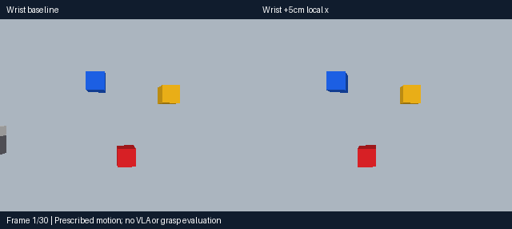

# 用户 Colab 相机横向偏移对照

**记录编号：USER-20261127-002。状态：运行完成，五个原始文件已核对；本阶段实验到此收尾。**

用户在完成 [第一次双视角仿真](../20261127T044151Z/record.md) 后，执行 AI 助手协助准备的下一格代码，并上传动图、截图、实际脚本、元数据及源码派生记录。本目录按原始字节保存这些附件，仅将上传时带有 `(1)` 的文件名恢复为标准名称。核查没有重新运行仿真。

## 直接查看结果



| 左侧：Wrist baseline | 右侧：Wrist +5cm local x |
| --- | --- |
| 原始手腕相机安装 | 沿原始相机的光学局部 +x 方向平移 5 cm |
| 朝向保持原值 | 与左侧相同的朝向 |

两路图像在同一物理状态下连续渲染，中间没有执行物理步进。场景、关节控制、物理步数、投影及采样时序与第一轮脚本相同。

| 文件 | 内容 |
| --- | --- |
| [comparison.gif](comparison.gif) | 30 帧双视角动画，一轮 3 秒 |
| [comparison.png](comparison.png) | 第 11 帧截图 |
| [demo.py](demo.py) | 用户本次执行并上传的脚本 |
| [metadata.json](metadata.json) | 软件版本、运行时间和 30 组关节及相机状态 |
| [derivation.json](derivation.json) | 基础脚本来源、源码指纹和对照修改说明 |
| [config.json](config.json) | 从源码与元数据整理的配置快照，并非原始运行输入 |
| [checksums.json](checksums.json) | 五个原始文件的 SHA-256 与字节数 |
| [verification.json](verification.json) | 本次一致性核查的数值、方法和适用范围 |

## 实际运行与核查

| 项目 | 结果 |
| --- | --- |
| 开始时间 | 2026-11-27 05:45:46.238001 UTC |
| 完成时间 | 2026-11-27 05:45:54.058647 UTC |
| 脚本内记录的墙钟耗时 | 7.820646 秒；不作为性能对比结论 |
| 环境版本 | Python 3.11.18；PyBullet 3.2.7；NumPy 2.4.6；Pillow 13.0.0 |
| 图像与时序 | 30 帧、每帧 100 ms、每路 320×240；含标题的合成图为 640×286 |
| 源码对应关系 | 实际脚本 SHA-256 与 metadata、derivation 和已准备入口的派生版本完全一致 |
| 相机间距离 | 30 帧均为 0.05 m，误差处于浮点精度范围 |
| 两相机朝向 | 30 帧的旋转矩阵差均为 0 |
| 与第一轮的关节、手部及基准相机状态 | 30 组对应记录的最大差均为 0 |
| 图像对应关系 | PNG 与 GIF 第 11 帧逐像素相同；基准视角与第一轮同帧的手腕视角逐像素相同 |

本次源代码 SHA-256 为 `7918adaebf5c622f19e04a6139676d6822d6aa7c6a9dffea4cec0ccf1f256103`。Colab 运行背景来自用户的操作记录与上传上下文，原始元数据自身不含运行平台标识。

## 相机关系

使用列向量和米制单位。相机光学坐标为 x 向右、y 向下、z 向前：

```text
world_from_shifted_camera = world_from_baseline_camera @ Tx(0.05 m)
```

这表示沿基准相机自身的右方移动，不能解释为始终沿世界坐标 x 方向移动。两组固定的手部安装矩阵分别为 `mount` 和 `mount @ Tx(0.05)`。

30 帧的上述相机组合残差为 0；从手部位姿和安装矩阵组合相机位姿的最大残差约为 2.22 × 10⁻¹⁶。这些是记录内部的一致性检查，不是独立的真实相机标定验证。

## 观察与含义

第 11 帧中，右侧图像的红、蓝、黄方块区域相对左侧整体向左移动。它与相机向自身右侧平移时，目标投影向左变化的几何关系一致。

**红色方块在两幅图像的下边缘仍有截断。** 简单 RGB 阈值检查在两路图像的第 6–11 帧均检出红色区域接触最下方像素行。纯横向平移没有直接解决这次的下缘裁切；不能把这组偏移称为“视野改善”或“性能提升”。阈值检查仅用于辅助观察，不是语义分割真值或正式目标可见率。

## 本阶段完成范围

用户已在 AI 辅助下完成基础场景运行、固定与手腕双视角采集，以及一次只改变横向相机安装位置的对照，并保留可核对的代码和输出。

本次仍是预设关节运动，尚未进行抓取任务、VLA 模型训练或成功率评测。师兄提供的 RP 作为外部背景材料，不将其中的研究方案或成果归为本次个人原创。

按用户要求，实验在这两次运行后收尾，当前工作转为整理组会进度汇报；不自动追加新实验。
